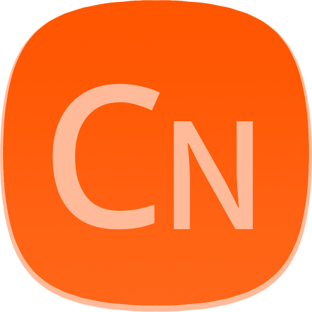

# ClickGo Native

<p align="center"></p>
<p align="center">
    <a href="https://github.com/maiyun/clickgo-native/blob/master/LICENSE">
        
    </a>
    <a href="https://www.npmjs.com/package/clickgo-native">
        
    </a>
    <a href="https://github.com/maiyun/clickgo-native/releases">
        
    </a>
    <a href="https://github.com/maiyun/clickgo-native/issues">
        
    </a>
</p>

[简体中文](./doc/README.sc.md)

The software developed with ClickGo will run in Windows, Mac OS, Linux.

## Installation

You can install directly using NPM:

```sh
$ npm i clickgo-native --save
```

This installation step is for application developers. End users install your packaged software; they do not need a separate Node.js installation or a global clickgo-native package.

**Native main process**

```typescript
import * as native from 'clickgo-native';
class Boot extends native.AbstractBoot {
    public onOpenFiles(paths: string[]): void {
        console.log(paths);
    }

    public main(): void {
        this.run(native.path(import.meta.url, './index.html'), {
            'frame': false,
            'icon': native.path(import.meta.url, './logo.png'),
        });
    }
}
native.launcher(new Boot(), {
    'openFiles': true,
    'singleInstance': true,
});
```

`launcher()` configures process-level behavior before Electron becomes ready. `openFiles` forwards files received from associations, command-line launches, and window drops to `onOpenFiles()`. `singleInstance` prevents duplicate application processes and activates the existing window when another instance starts. These options are independent; use either one without enabling the other when appropriate.

`launcher()` also provides the software's [CLI and stdio modes](#cli-and-stdio-mcp). Put business startup in `Boot.main()` and keep stdio stdout reserved for MCP.

`icon` supplies the native window icon on Windows and Linux. Include this file in the application's packaged files; `build.linux.icon` configures the installed application-list icon separately. When packaging through ClickGo Compiler, set `build.linux.icon` to a single square PNG of at least 256×256 pixels (512×512 or 1024×1024 is recommended). The compiler automatically generates standard Linux icon sizes in a temporary directory and cleans them up after packaging; the source image and configuration are not changed. Existing multi-size PNG directories remain supported. Also set the application's `desktopName` and `build.linux.syncDesktopName: true` to associate the running window with its desktop entry.

For frameless ClickGo applications, the first Form synchronizes its `minWidth` and `minHeight` to the native window, including subsequent changes. System close requests (such as Alt+F4) are forwarded to that Form's `close` event. Call `event.preventDefault()` synchronously before showing an asynchronous ClickGo confirmation, then close the Form after confirmation. Explicit `native.close()` and `native.quit()` are final, authorized close actions and do not repeat the confirmation. These integrations require the corresponding updated ClickGo runtime as well as ClickGo Native.

## Build a ClickGo Application as a Native Package

The application project does not need to install `electron` directly when using ClickGo Compiler to run and package it. The compiler supplies the Electron runtime. Native main-process code can use `native.getAppVersion()` to read the application's `package.json` version and `native.isPackaged()` to distinguish a packaged application from development runs. These APIs do not expose Electron to the HTML page.

Building a desktop application consists of two steps: compile the ClickGo application into a `.cga` file, then package the Native project with Electron.

Install the compiler globally first:

```sh
$ npm i -g clickgo-compiler
```

Use the following layout as a starting point. The `dist/test` directory in this repository is a complete working example.

```text
package.json
tsconfig.json
dist/
  index.ts
  index.html
  browser.ts
  app/
    app.ts
    config.json
    form/
```

The project `package.json` must use the compiled Native entry as `main`:

```json
{
    "type": "module",
    "main": "dist/index.js"
}
```

The Native page must provide the ClickGo runtime and load the compiled browser entry:

```html
<script type="importmap">
{
    "imports": {
        "clickgo": "https://js.maiyun.net/npm/clickgo@x.x.x/dist/index.js"
    }
}
</script>
<script type="module" src="browser.js"></script>
```

Compile the ClickGo application source into `dist/app.cga`:

```sh
$ npx tsc
$ clickgo --app ./dist/app --save ./dist/app
```

Load the generated application from the browser entry:

```typescript
import * as clickgo from 'clickgo';

class Boot extends clickgo.AbstractBoot {
    public async main(): Promise<void> {
        const taskId = await clickgo.task.run(this._sysId, 'app.cga', {
            'permissions': ['root'],
        });
        if (typeof taskId !== 'string') {
            console.error(`Load application failed (${taskId}).`);
            return;
        }
    }
}

await clickgo.launcher(new Boot());
```

Run the Native project without generating an installer:

```sh
$ clickgo --run ./dist/index.js
```

Run the following command from the directory containing `package.json` to generate a distributable package:

```sh
$ clickgo --native --platform win
$ clickgo --native --platform linux
$ clickgo --native --platform mac
```

When building the Linux `rpm` target, ensure that `rpmbuild` is installed on the build host. On Ubuntu or Debian, install it before packaging:

```sh
$ sudo apt install rpm
```

On other Linux distributions, use the system package manager to install the package that provides `rpmbuild`. This tool is required for RPM packaging, not for the AppImage or DEB targets.

When downloading Electron in mainland China, enable the mirror:

```sh
$ clickgo --native --platform win --mirror cn
```

`clickgo --app` generates the ClickGo `.cga` application, `clickgo --run` only starts the Native project for testing, and `clickgo --native` invokes Electron Builder to generate the desktop distribution. Build on the target operating system when platform-specific signing or installer tooling is required.

## Demo

Clone, build the current ClickGo test application, and run it with Electron:

```sh
$ npm i -g clickgo-compiler
$ npm install
$ npm run build
$ npm run native
```

## Persistent storage

Use `native.storage.get/set/remove` for JSON settings and `native.secret.get/set/remove` for encrypted strings. Data lives in the software's user data directory and survives restart. Check `await native.secret.isAvailable()` before saving credentials; unavailable secure storage never falls back to plaintext.

Reads return `null` for a missing key and `false` for failure. Configuration reads return `{ value }`, so stored `false` and `null` remain distinct. ClickGo Apps use the same APIs as `clickgo.native.storage` / `clickgo.native.secret`, with `this` as the first argument, without `root` permission. Set a unique `id` in the App's `config.json`, such as `net.example.app`; keep it unchanged across moves and upgrades. The same ID shares storage across instances; different IDs and the host have separate storage. Apps share the host page's trust boundary; IDs partition their data. Data operations return `false` without a valid ID. See **Library native** in the ClickGo Demo for examples.

## Local MCP

ClickGo Native exposes App commands through Streamable HTTP, stdio MCP and CLI, sharing the same execution as buttons and menus.

First register the App's commands with `clickgo.command.register()` and `exposed: true`; UI actions use `clickgo.command.execute()`. See the [complete command example](doc/mcp.md#command-registration).

### Enable the service

Create the window and enable MCP in the Native main process:

```typescript
import * as native from 'clickgo-native';

class Boot extends native.AbstractBoot {
    public async main(): Promise<void> {
        this.run(native.path(import.meta.url, './index.html'), { 'frame': false });
        const info = await native.startMcp();
        if (info === false) {
            return;
        }
        // Provide info.url and info.token through the application's connection settings.
    }
}

native.launcher(new Boot(), { 'commandAutoStart': true });
```

`startMcp()` chooses a loopback port and random token. The launcher option lets CLI/stdio open the GUI when needed; omit it to use only an already running GUI. Keep credentials private.

### Connect over HTTP

Use the current URL and token returned by `startMcp()` in the client's connection settings:

```json
{
    "url": "<url-from-connection-settings>",
    "headers": { "Authorization": "Bearer <token>" }
}
```

MCP clients discover Apps with `clickgo_list_apps`, inspect the selected App with `clickgo_list_commands`, then call `clickgo_execute_command`. Copy the chosen App's `id` into `taskId`; rediscover it after restart. Only exposed, enabled commands can be executed.

## CLI and stdio MCP

These modes use the installed software's executable and default local discovery. End users need no additional Node.js or global npm package. Use the `.exe` on Windows, the binary inside `.app/Contents/MacOS/` on macOS, or the binary/AppImage on Linux.

**stdio MCP** — for clients with a `mcpServers` configuration:

```json
{
    "mcpServers": {
        "my-software": {
            "command": "<absolute-path-to-installed-software>",
            "args": ["--mcp"]
        }
    }
}
```

**CLI** — start with help and App discovery, using Linux as an example:

```sh
./MySoftware --cli --help
./MySoftware --cli apps
```

### Generate an AI access guide

A ClickGo App or Form can generate ready-to-share English instructions for its actual environment:

```typescript
const guide = await clickgo.command.getAgentGuide(this);
if (guide === null || guide === false) {
    return;
}
// Display or copy guide in the application's AI access screen.
```

The guide covers browser JS/WebMCP, Native stdio/CLI and how to obtain HTTP settings. It omits credentials and transient App IDs by default; `getAgentInfo(this)` provides the detailed snapshot.

See the [MCP and CLI guide](doc/mcp.md) for configuration options, credential export, multiple instances, cancellation and development tests.

## License

This library is published under [Apache-2.0](./LICENSE) license.
